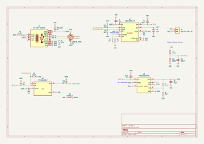
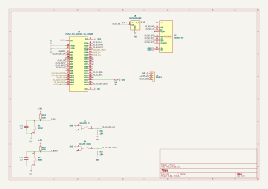
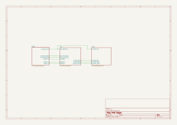
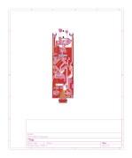
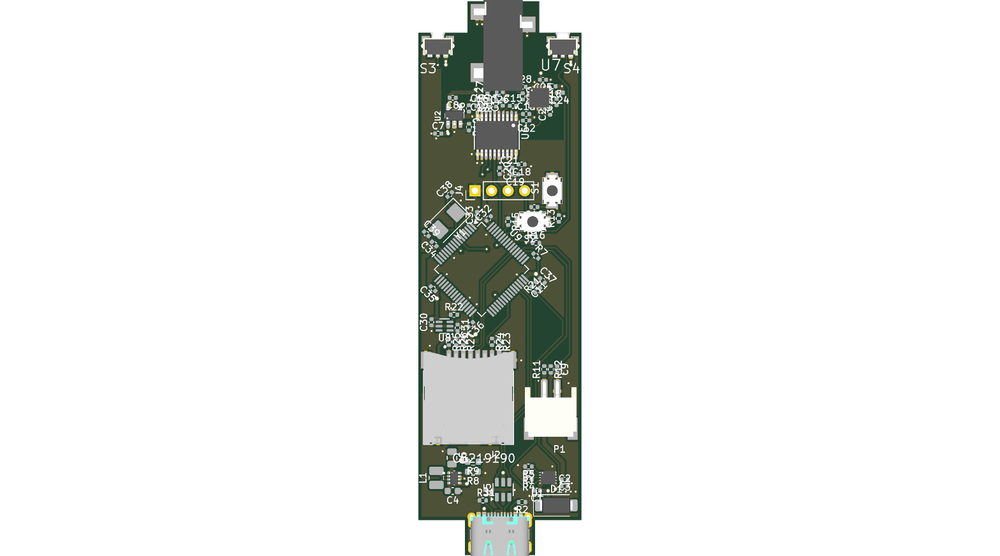

- [Part choices & planning](./docs/Parts.md)

- Datasheets, symbols, footprints, 3d models, and spice models are in the respective folders in `./parts`

## Schematics

### Power

### MCU

### Audio

### Root

## PCB

### Rendered

